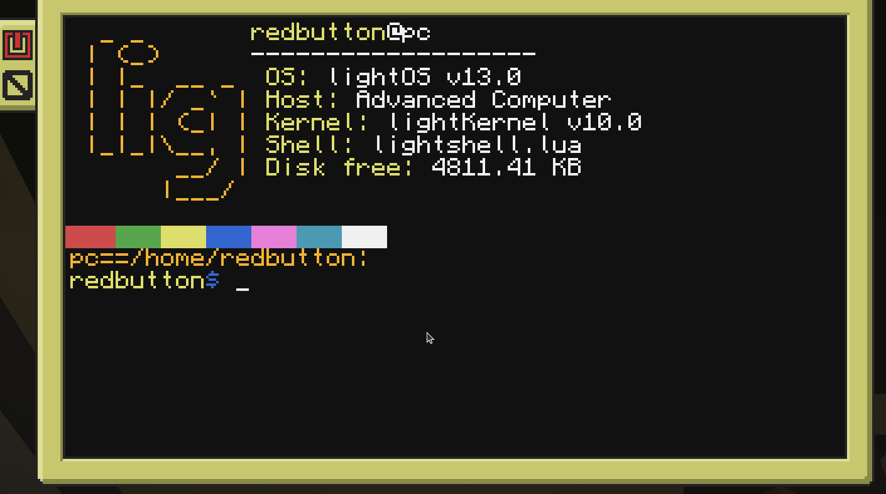
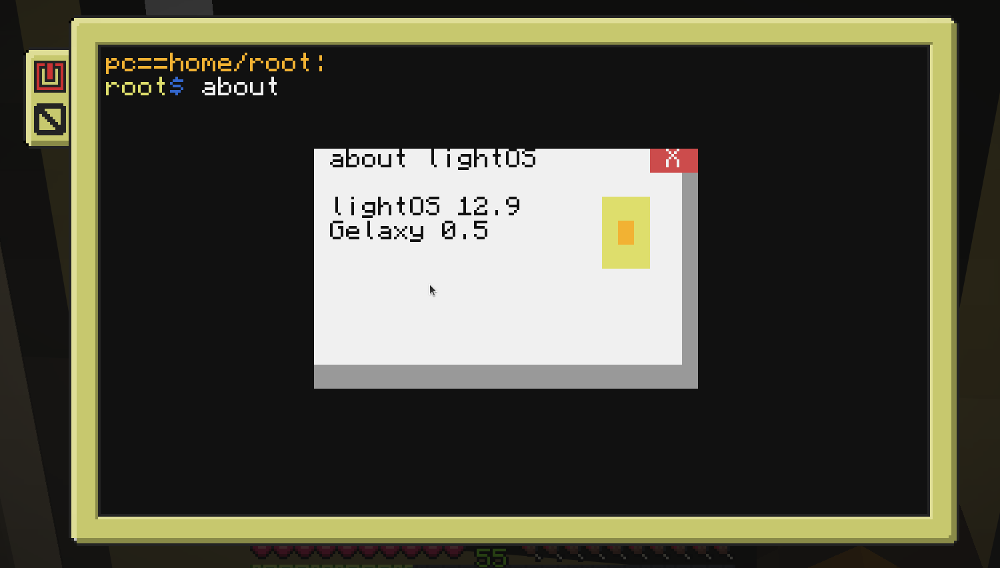
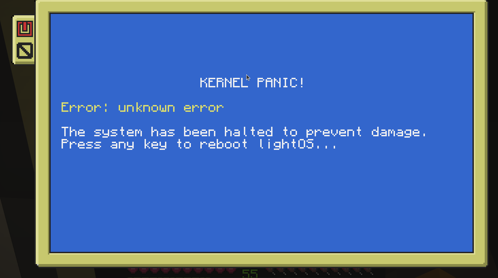

# lightOS
## For ComputerCraft and it fork CC: Tweaked

### To install os need 3mb to install correctly


<p align="center">
  
  
  
</p>

## See full documentation on https://lightos.madefor.cc
## To install the lightOS
```
pastebin run 7pwFMZW8
```
### You can use tsToLua on beta/lightOS-ts

## please download from commit eba6731ec00754a9c7b1526b1e53e63e8b6c6a1e

### The lightOS under GNU GPL License version 3.0 or above you can read license in file License

#### Please read a documentations in Docs/

## Changes:
```
+ New Architecture

New command 
+ `snowfall`

```
